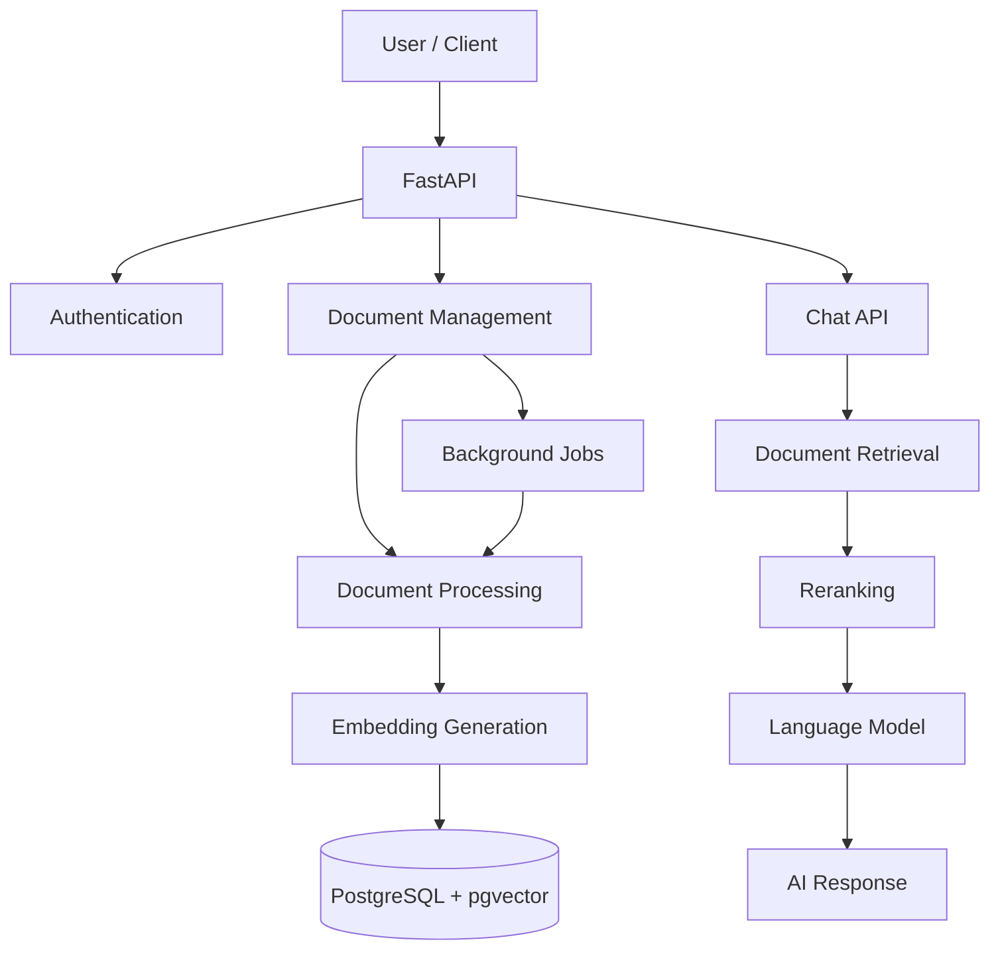

# Smart Knowledge Assistant

A multi-tenant AI knowledge assistant backend built with FastAPI, PostgreSQL, and Retrieval-Augmented Generation (RAG).

[](https://www.python.org/)
[](https://fastapi.tiangolo.com/)
[](https://www.postgresql.org/)
[]()

## Overview

I started this project to find out what a knowledge assistant looks like when it's more than a chatbot with a nice prompt. The idea is simple: you upload your own documents, they become your personal knowledge base, and you ask questions about them in a chat.

The backend is multi-tenant, so every user's documents, conversations, and knowledge base stay separate from everyone else's.

Plugging an LLM into an endpoint is the easy part. Most of my time goes into what surrounds it: processing documents, generating embeddings, retrieving the right passages, designing the database, running background jobs, and structuring the API.

It's still a work in progress. Some parts are implemented, and others are still being reworked.

## What's in it

The project covers a handful of areas:

- Users can register, log in, and reach protected API routes.
- Documents are uploaded and managed as part of a user's knowledge base.
- Content is extracted from supported file formats and prepared for retrieval.
- Embeddings are generated and stored so documents can be searched with vector search.
- Chat retrieves relevant information from a user's documents to give context-aware answers, and it keeps the conversation history.
- Work that shouldn't block an API request runs as asynchronous background jobs.

What exactly is covered keeps changing as I build.

## Technology stack

| Area | Technologies |
|---|---|
| Backend | Python, FastAPI |
| Database | PostgreSQL |
| ORM | SQLAlchemy 2.x |
| Vector search | pgvector |
| Database migrations | Alembic |
| Caching and background jobs | Redis, Celery |
| AI and embeddings | OpenAI, Sentence Transformers |
| Retrieval | BM25 |
| Reranking | FlashRank |
| Validation and configuration | Pydantic, Pydantic Settings |
| Document parsing | pypdf, python-docx |
| Logging | Structlog |
| Testing and code quality | Pytest, Ruff, Mypy |

## Architecture

This is the flow I'm aiming for. Treat it as a conceptual overview, not a promise that every box and arrow is wired up today.



## Project structure

The backend is split into separate areas so routes, core infrastructure, and business logic stay easy to maintain. Right now the main application has:

- `app/api/routers/`: route modules for authentication, documents, chat, and health checks.
- `app/core/`: configuration, database setup, logging, middleware, and exception handling.
- `alembic/`: migration configuration and revisions.
- `tests/`: automated tests.

Expect this layout to change as new features and modules arrive.

## Getting started

### Prerequisites

You'll need:

- Python 3.12 or later
- PostgreSQL with the pgvector extension
- Redis
- [uv](https://docs.astral.sh/uv/) for Python dependency management

### Installation

Clone the repository:

```bash
git clone https://github.com/Awais-Nazir/knowledge-assistant.git
cd knowledge-assistant
```

Install the dependencies:

```bash
uv sync --extra dev
```

### Environment configuration

Create a local environment file and fill in the settings you need. Depending on which features you run, that includes the database connection, authentication settings, allowed frontend origins, and AI provider credentials.

**Never commit your real `.env` file, API keys, database passwords, or any other credentials.**

### Database setup

Make sure PostgreSQL is running and that the database and the pgvector extension are available. Then apply the migrations:

```bash
uv run alembic upgrade head
```

### Run the API

Start the development server:

```bash
uv run uvicorn app.main:app --reload
```

In a development environment, the API docs are available at:

- Swagger UI: `http://localhost:8000/docs`
- ReDoc: `http://localhost:8000/redoc`

The application configuration turns these docs endpoints off in production mode.

> Note: Background workers and any other infrastructure should be started according to the project's current configuration.

## Development

I build this project in small steps and use it to try out backend ideas and see what trade-offs come up in AI applications.

The goal goes beyond connecting an LLM to an API. I'm after the system around it: reliable data handling, user isolation, document processing, good retrieval quality, and backend services that stay maintainable.

## Current status

In development. Features, architecture, and implementation details may change as I keep working on it.

## Future improvements

Things I plan to keep working on:

- Better document extraction and chunking.
- Experiments with hybrid retrieval and reranking.
- Tighter tenant isolation and access control.
- Better background processing and failure handling.
- More automated tests and better observability.
- Evaluating retrieval quality and how relevant the responses are.

## Author

**Muhammad Awais Nazir**

I'm a backend developer who likes building reliable systems and adding AI to practical applications.

- GitHub: [Awais-Nazir](https://github.com/Awais-Nazir)
