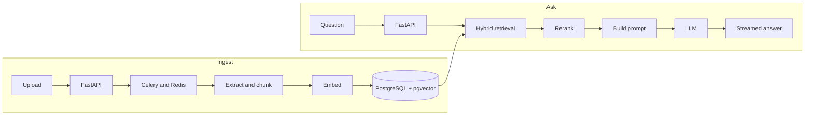

# Knowledge Assistant

A multi-tenant RAG backend built with FastAPI and PostgreSQL. You upload your own documents and chat with them. Each user's documents, chats and search results stay separate from everyone else's.

Live app: [ai-rag.awaisnazir.tech](https://ai-rag.awaisnazir.tech). It's a web client called Folio that runs on this API, and you need to create an account to use it.

Status: in development. The last two sections list what works and what doesn't.

## Why I built it

I wanted to see what a knowledge assistant looks like when it's more than a chatbot with a nice prompt. Calling an LLM from an endpoint is the easy part. Most of the work is around it: processing documents, generating embeddings, retrieving the right passages, designing the database, running background jobs and structuring the API.

## How it works

When you upload a document, a Celery worker extracts the text, splits it into chunks, embeds them and stores them in PostgreSQL with pgvector.

When you ask a question:

1. The question is embedded and searched against your own chunks two ways: vector search with pgvector and keyword search with BM25.
2. The two rankings are merged with reciprocal rank fusion into 20 candidates.
3. FlashRank reranks the candidates and the top 5 are kept.
4. The prompt is built from those chunks, a summary of the earlier conversation and the most recent messages.
5. The LLM streams its answer back over server-sent events.



## Technology stack

| Area | Technologies |
|---|---|
| Backend | Python, FastAPI |
| Database | PostgreSQL |
| ORM | SQLAlchemy 2.x |
| Vector search | pgvector |
| Database migrations | Alembic |
| Caching and background jobs | Redis, Celery |
| AI and embeddings | OpenAI, Sentence Transformers |
| Retrieval | BM25 |
| Reranking | FlashRank |
| Validation and configuration | Pydantic, Pydantic Settings |
| Document parsing | pypdf, python-docx |
| Logging | Structlog |
| Testing and code quality | Pytest, Ruff, Mypy |

Models are picked through environment variables. The defaults are OpenAI's `text-embedding-3-small` for embeddings and `gpt-4o-mini` for the LLM, with FlashRank for reranking. `.env.example` lists the other provider options.

## Project structure

- `app/api/routers/`: routes for auth, documents, chat and health checks.
- `app/services/` and `app/repositories/`: business logic and database access.
- `app/rag/`: chunking, hybrid retrieval, reranking, prompt building and the pipeline that ties them together.
- `app/workers/`: Celery app and background tasks.
- `app/models/` and `app/schemas/`: SQLAlchemy models and Pydantic schemas.
- `app/core/`: configuration, database setup, logging, middleware and exception handling.
- `alembic/`: migrations.
- `tests/`: automated tests.

## Getting started

You need Python 3.12 or later, [uv](https://docs.astral.sh/uv/), and Docker (for PostgreSQL with pgvector, and Redis).

```bash
git clone https://github.com/Awais-Nazir/knowledge-assistant.git
cd knowledge-assistant
uv sync --extra dev
cp .env.example .env
```

Open `.env` and set at least `SECRET_KEY` and `OPENAI_API_KEY`. The database and Redis URLs already match the Docker Compose file. Don't commit your real `.env`.

Start PostgreSQL and Redis, then apply the migrations:

```bash
docker compose up -d
uv run alembic upgrade head
```

Run the API and the worker in two terminals:

```bash
uv run uvicorn app.main:app --reload --port 8000
uv run celery -A app.workers.celery_app worker --loglevel=info
```

On Windows, add `--pool=solo` to the Celery command.

The same commands are available as `make up`, `make migrate`, `make run` and `make worker`.

In development, the API docs are at `http://localhost:8000/docs` (Swagger) and `http://localhost:8000/redoc`. They are turned off when `APP_ENV` is `production`.

Run the tests with `uv run pytest -v`.

## What works today

- Register, log in, refresh and log out with JWT, plus an endpoint for the current user.
- Upload, list and delete documents. Processing runs in a Celery worker, so uploads don't block requests.
- Hybrid retrieval and reranking as described above, scoped to the current user.
- Streaming chat, with sessions you can list, open, rename and delete.
- Alembic migrations, Docker Compose for local services, a production compose file with an nginx config, and a GitHub Actions workflow.

## Not done yet

- The test suite is three placeholder tests (config, password hashing, exceptions). Nothing tests retrieval, the auth endpoints or tenant isolation yet.
- The BM25 index is rebuilt from all of a user's chunks on every question. That is fine for a small library and slow for a large one. Moving keyword search into PostgreSQL full-text search is the likely fix.
- There is no retrieval evaluation, so I can't yet say how good the answers are, only that the pipeline runs.

## Author

Muhammad Awais Nazir, a backend engineer. [Portfolio](https://awaisnazir.tech) | [GitHub](https://github.com/Awais-Nazir)
